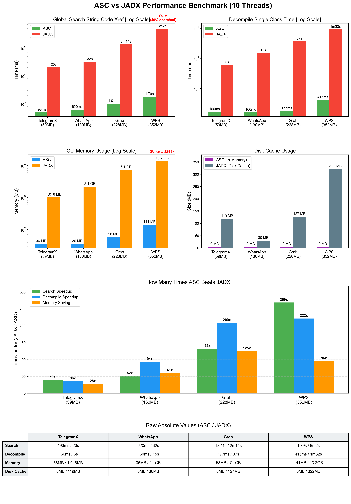

# Droid ASC: R8 Compiler Optimization as a DeCompiler Primitive

[](https://madewithrea.com/builds/droid-asc-fast-android-decompiler-built-for-agents-and-mobile-research)

> **Rust version:** This project has been rewritten 1:1 in Rust as [rust_ASC](https://github.com/MG1937/rust_ASC). The Rust version is 10× faster and supports full APK decompilation: with 16 threads, it decompiles a 383 MB APK in just 4 seconds.
>
> If your workflow is written in Python, you can continue integrating with this project; it remains the fastest Python Android decompiler available. If you only need a binary, please use [rust_ASC](https://github.com/MG1937/rust_ASC).
>
> ASC and rust_ASC will be maintained in parallel, so users can choose the integration style that best fits their workflow.

https://blackhat.com/europe/arsenal/schedule/index.html#droid-asc-r8-compiler-optimization-as-a-decompiler-primitive-54834  

When decompiling massive Android APKs, the standard procedure is to wait. We wait for tools to eat gigabytes of RAM, fully inflate the artifacts, and spend tens of minutes building heavy global indexes and cross references... All of this is just to guarantee fast code searches later, but here is the contradiction. A compiled artifact is already highly structured, modern decompilers never utilize this, they waste massive amounts of time and memory reconstructing a bloated database of code relationships over already structured data. This engineering approach defies common sense. When I can directly extract any code relationship from the APK in milliseconds, does this preprocessing still hold any value?  

Instead of forcing decompilers into heavy preprocessing, we choose to query the compiled artifact directly as a database. We built a stateless, zero-overhead engine that extracts and searches code on demand in milliseconds. In this briefing, we will explore the underlying engineering required to bypass traditional bottlenecks. We will demonstrate how to abandon full inflate by probing directly within the Deflate bitstream, building dense Huffman lookup tables to extract core metadata without touching irrelevant data blocks. Furthermore, we will explain optimization details of the R8 compiler, especially how deterministic constant relocation and instruction deduplication leave behind highly concentrated physical layouts, we weaponize this compiler behavior to execute lightning-fast cross DEX code searches. To map these raw bytecode offsets back to methods, we engineered an O(1) instruction locating primitive, achieving constant-time method resolution without building heavy mapping tables. Finally, upon hitting a target, Droid ASC extracts only the specific bytecodes and its dependencies, dynamically reconstructing a minimal and self consistent DEX entirely in memory for instant decompilation.  

We will demonstrate this architecture live against a 352MB commercial APK. Droid ASC executes global cross reference searches in 1.79 seconds and decompiles target classes in 177 milliseconds using only 141MB of RAM. By treating the artifact as a read only database and operating with zero preprocessing, we return the decompiler to its core essence. It is no longer a bloated indexing tool, but a lightning fast, on demand decompilation engine that fundamentally redefines how we analyze compiled code.  

# Benchmark


https://github.com/user-attachments/assets/4c4a6813-8561-490c-a573-ef113da861b6

Raw absolute values, measured with 10 threads across four APK targets of
increasing size:

**Global string xref search**

| Tool | TelegramX (59MB) | WhatsApp (130MB) | Grab (228MB) | Lark (352MB) |
| --- | --- | --- | --- | --- |
| ASC | 322ms | 418ms | 806ms | 1.597s |
| JADX | 20s | 32s | 2m14s | 8m2s |

ASC is 62x to 302x faster than JADX for global string xref search.

**Single-class decompile**

| Tool | TelegramX (59MB) | WhatsApp (130MB) | Grab (228MB) | Lark (352MB) |
| --- | --- | --- | --- | --- |
| ASC | 157ms | 141ms | 165ms | 303ms |
| JADX | 6s | 15s | 37s | 1m32s |

ASC is 38x to 304x faster than JADX for single-class decompile.

**CLI memory usage**

| Tool | TelegramX (59MB) | WhatsApp (130MB) | Grab (228MB) | Lark (352MB) |
| --- | --- | --- | --- | --- |
| ASC | 36MB | 36MB | 58MB | 141MB |
| JADX | 1,016MB | 2.1GB | 7.1GB | 13.2GB |

ASC uses 28x to 125x less memory than JADX for CLI operation.

**Disk cache usage**

| Tool | TelegramX (59MB) | WhatsApp (130MB) | Grab (228MB) | Lark (352MB) |
| --- | --- | --- | --- | --- |
| ASC | 0MB | 0MB | 0MB | 0MB |
| JADX | 119MB | 30MB | 127MB | 322MB |

ASC stays fully in memory with zero disk cache, while JADX writes up to 322MB.

Note: JADX runs out of memory on the largest target (Lark) during the global
search (~49% searched), while ASC completes every target.

As the benchmark shows, ASC is 62x faster than JADX on ~50MB APKs, and 302x
faster on ~300MB APKs, with a tiny memory footprint. Agents can pair with ASC
to analyze dozens or even hundreds of APKs at once, even on weak machines.
The JADX MCP has a harder time here: JADX alone uses several GB just to
preload, which makes switching between hundreds of APKs impractical.

# Install
```bash
# from PyPI
pip install droidasc

# or from source
pip install .
```

After installation, the `droidasc` CLI command is available globally:

```
usage: droidasc [-h] {getclass,disassemble,listclass,getmanifest,findrefs} ...

ASC tooling entry (v0.1.2.post1).

positional arguments:
  {getclass,disassemble,listclass,getmanifest,findrefs}
    getclass            Locate the target class in APK, extract one DEX in
                        memory, then decompile.
    disassemble         Extract a class, rebuild a small DEX, then disassemble
                        it with dadguard.
    listclass           List classes across all DEX entries; use --prefix to
                        filter by package/class prefix.
    getmanifest         Decode AndroidManifest.xml from APK and print it as
                        XML.
    findrefs            Find code references for string/type/method/field
                        across all DEX entries in APK.

options:
  -h, --help            show this help message and exit

examples:
  droidasc app.apk --gui
  droidasc getclass app.apk Lcom/poc/Main; -o Main.java
  droidasc getclass app.apk com.poc.Main --threads 16
  droidasc disassemble app.apk Lcom/poc/Main; -o Main.smali
  droidasc disassemble app.apk com.poc.Main --debug
  droidasc disassemble app.apk com.poc.Main --debuginfo
  droidasc disassemble app.apk com.poc.Main --method 'run(I)V'
  droidasc listclass app.apk
  droidasc listclass app.apk -o classes.txt
  droidasc listclass app.apk --prefix com.poc
  droidasc getmanifest app.apk
  droidasc getmanifest app.apk -o AndroidManifest.xml
  droidasc findrefs app.apk string token -o string_refs.txt
  droidasc findrefs app.apk type com.poc.Main
  droidasc findrefs app.apk method onCreate --class com.poc.Main
  droidasc findrefs app.apk method notify --class MainActivity --fuzzy-class -o method_refs.txt
  droidasc findrefs app.apk field apiKey -o field_refs.txt
  droidasc findrefs app.apk extends java.lang.Object
  droidasc findrefs app.apk extends android.app.Activity -o subclasses.txt
  droidasc findrefs app.apk impl android.os.IInterface -o impls.txt
```

`-V`/`--version` prints the installed package version.

`findrefs` searches for code references (string/type/method/field) across all
DEX entries; `-o` writes results to the selected file instead of stdout, and
`--threads N` controls the worker pool. `extends`/`impl` locate classes that
extend a target class or implement a target interface, respectively.

`listclass` prints Dalvik class descriptors in APK/DEX definition order, one per
line. With `-o`, output is written to the selected file instead of stdout.
`--prefix com.poc` filters by `Lcom/poc`; an already normalized prefix such as
`Lcom/poc` is kept unchanged.

`disassemble` accepts the same dotted or Dalvik class formats as `getclass`.
It extracts the target class from the APK, rebuilds a small DEX in memory, and
disassembles the rebuilt DEX with `dadguard`. `--debug` enables timing output
and instruction offset comments; `--debuginfo` enables DEX `.line` and local
variable directives. `--method 'run(I)V'` restricts output to one exact method
signature; a bare method name is rejected. All commands that support `-o` write
to stdout when `-o` is omitted.

You can also use `python main.py` as before — it delegates to the same entry point.

# Sponsors

| Sponsor | Amount |
| --- | ---: |
| [HTTChina](https://github.com/HTTChina) | 5000￥ |
| [c01ns](https://github.com/c01ns) | 11.9￥ |
| [gguowang](https://github.com/gguowang) AND [cococount](https://github.com/cococount) | 2￥ |
| [Ylarod](https://github.com/Ylarod) | 50.11￥ |  

Thank you to all sponsors for your support!  

ASC is built with the hope that it can genuinely help everyone improve their reverse engineering workflow — from speeding up the tedious parts to making the impossible feel routine.

# Acknowledgements

Thanks to the [Androguard](https://github.com/androguard/androguard) project
for providing the Android reverse-engineering and DEX analysis foundation used
by Droid ASC.
